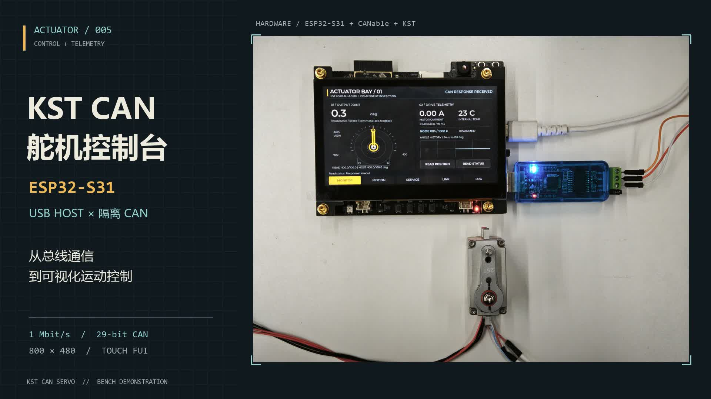

# ESP32-S31 KST Servo：CAN 舵机控制与遥测台

**中文** | [English](README.en.md)

把 KST CAN 舵机接到 ESP32-S31-Korvo-1 的 USB-A，在原装触摸屏上完成位置控制、轨迹演示和运行状态查看。仓库提供可移植 C 驱动、candleLight USB Host 适配器，以及五页 LVGL 机甲部件检测界面。

[](docs/media/servo-showcase.mp4)

[观看 44 秒实拍演示](docs/media/servo-showcase.mp4) · [接线与板型](docs/HARDWARE.md) · [操作说明](docs/OPERATIONS.md) · [功能与验证范围](docs/FUNCTIONS.md)

## 为什么做这个

我想把舵机调试做成一台独立的小终端：屏幕上能看清目标和实际位置，也能查看电流、温度、通信状态和参数。操作不必一直依赖电脑，移植驱动时也不必连带搬走整套 UI。

Korvo 的 USB-A 直接连接隔离 CANable，避免从板上引出 TWAI GPIO。舵机协议、同步事务和传输适配器分开实现；如果你的控制器没有 USB Host，也可以保留上层驱动，换成自己的 CAN 收发接口。

这版已经在 **KST HS20-12-M-5518-3.2、固件 3.66、节点 5、1 Mbit/s** 的实物上跑通读取、手动定位和有限往返演示。协议实现依据 KST 扩展帧协议 V3.61B，包含针对这只 3.66 实物回复格式的兼容处理。它不是通用 CANopen 驱动，也不适用于同系列的 PWM、RS485 或标准帧版本。

## 可以拿来做什么

- **独立调试台**：在 800 × 480 触摸屏上查看角度、电流、温度、趋势与通信事件，手动设置位置或执行有限轨迹。
- **可复用驱动**：纯 C 协议层无操作系统和堆内存依赖；事务层只需注入发送、接收、单调时钟三个回调。
- **USB-CAN 接入示例**：实现 candleLight / gs_usb 枚举、位时序、扩展帧收发、拔插和显式重连。
- **参数调试入口**：提供上报、间隔、限位、设零、保存、节点和波特率操作，明确区分发送结果与设备回复。
- **可观察的运动控制**：上电只读，ARM 后才允许发送；反馈陈旧、通信故障或设备异常会撤销运动解锁。

## 硬件连接

```text
ESP32-S31-Korvo-1 USB-A
        │ USB 数据线
隔离 CANable / candleLight（gs_usb）
        │ CANH / CANL / 总线侧参考地
KST HS20-12-M-5518-3.2 ← 独立 12 V 电源
```

| 部件 | 本项目配置 |
|---|---|
| 控制板 | ESP32-S31-Korvo-1，原装 800 × 480 触摸屏，16 MB Flash |
| USB-CAN | 实物隔离 CANable 1.0，使用匹配板型的 candleLight 固件 |
| CAN | 经典 CAN，29 位扩展数据帧，项目默认 1 Mbit/s、节点 5 |
| 舵机 | KST HS20-12-M-5518-3.2，实物固件 3.66，独立 12 V 供电 |
| 可选接口 | 原生 TWAI + 外部 CAN 收发器，需按板级说明连接 GPIO |

适配器须报告单通道和 `ONE_SHOT` 能力。PCAN、SLCAN 和 DFU 模式不能直接用于当前 USB 驱动；同名 CANable 克隆板也不能据此互刷固件。板型、隔离侧接地、终端电阻和接线见 [HARDWARE](docs/HARDWARE.md)，适配器要求见 [USB_CANDLELIGHT](docs/USB_CANDLELIGHT.md)。

## 编译与首次运行

### 1. 准备 SDK

需要支持 `esp32s31` 的 **ESP-IDF 6.2 preview**。本项目使用的 SDK 提交为 [`c712a0dde385d659a1470a136251980d31a70bc1`](https://github.com/espressif/esp-idf/commit/c712a0dde385d659a1470a136251980d31a70bc1)。ESP32-S3 工具链不能替代它。

Linux 下，在安装 ESP-IDF 所需的系统依赖后准备固定版本：

```sh
git clone https://github.com/espressif/esp-idf.git esp-idf-s31
cd esp-idf-s31
git checkout c712a0dde385d659a1470a136251980d31a70bc1
git submodule update --init --recursive
./install.sh esp32s31
. ./export.sh
cd ..
```

Windows 使用该版本 ESP-IDF 的安装与环境激活脚本；下面的 `idf.py` 命令在已激活的环境中同样适用。组件版本由 `dependencies.lock` 固定。

### 2. 克隆、配置、编译

```sh
git clone https://github.com/HwzLoveDz/esp32-s31-kst-servo.git
cd esp32-s31-kst-servo
idf.py --preview set-target esp32s31
idf.py --preview menuconfig
idf.py --preview build
```

在 `KST CAN servo / Korvo FUI` 菜单核对传输方式、节点、速率和超时。项目 `sdkconfig.defaults` 选择 **USB / 节点 5 / 1 Mbit/s**；协议库及独立 TWAI 示例保留厂家文档通用默认值 **节点 37 / 500 kbit/s**。换一只舵机时先核对其实际配置。

已激活 SDK 的 Windows PowerShell 也可以运行 `./build.ps1`。构建脚本只编译，不访问串口或烧写设备。

### 3. 烧录前核对分区

`partitions.csv` 面向 16 MB Flash：应用位于 `0x10000`、容量 8 MB，数据区位于 `0x810000`、容量 6 MB。先核对目标板已有分区；仓库中的布局不代表任意 Korvo 当前都使用这张表。

**仅当已有分区与本工程匹配时**，可替换 `PORT` 后执行应用烧录与监视：

```sh
idf.py --preview -p PORT app-flash monitor
```

不同布局或空白 Flash 的初始化见 [HARDWARE](docs/HARDWARE.md)。`release/kst-servo-fui-s31-axis-view.bin` 是应用镜像，不是含 bootloader 和分区表的完整固件包。应用不初始化或擦写上述数据区，也不启动相机、Wi-Fi 或音频业务。

### 4. 先读，再做小角度动作

1. 固定好舵机，给摇臂留出活动空间；按接线说明连接总线与独立电源。
2. 上电后在 **MONITOR** 等待真实角度、电流、温度出现，在 **LINK** 核对节点与版本。`--` 表示尚无有效数据。
3. 在 **MOTION** 以实际位置为参考设置小幅目标，按 **ARM MOTION → SEND POSITION**，观察实际反馈和机构运动。
4. 确认方向与限位后再运行有限往返。默认幅度 30°、总周期 6 秒，轨迹为 `当前位置 → 0 → +A → −A → 0`，不会循环不停。

默认启用的启动发现只在初始只读查询无回复时探测节点，结果写入串口日志；它不会自动改节点、改速率或恢复运动。首次操作与异常恢复详见 [OPERATIONS](docs/OPERATIONS.md)。

## 五页 FUI

| 页面 | 读者能完成的操作 |
|---|---|
| MONITOR | 看轴角度、目标与实际反馈、电流、温度、趋势、数据年龄及连接状态 |
| MOTION | 目标微调、预设角度、明确解锁与发送、有限平滑往返、暂停后续目标 |
| SERVICE | 上报与间隔、状态和功能位、限位、当前点设零、参数保存 |
| LINK | 读取和配置节点、8 档波特率、本地主机重连 |
| LOG | 查看收发统计、超时、ABORT 码和事件记录 |

首页摇臂图示按演示实物的观察方向绘制为正角逆时针；数字角度和运动指令保持原坐标。更换观察方向时应调整显示，不能靠反转反馈符号冒充机械方向设置。

## 使用前要知道的几件事

**目标与反馈范围分开。** 目标和限位写入保留协议的 ±100°，还会受已读回的设备限位约束；位置反馈接受 ±180°，用于显示和从目标范围外恢复。这只舵机曾拒绝 +180° 限位写入，所以当前版本不提供 360° 行程或多圈定位。遇到 `OUTSIDE TARGET LIMITS`，可选择最近合法边界并向范围内微调，再明确 ARM、SEND。

**3.66 功能开关只读。** 实物 FEATURES 返回 `0x5C90`，未定义的高字节会被完整保留。当前库和界面禁止对此值写入反向、低压报警开关；不会猜测格式或清零未知位。其余参数的实现与实测状态见 [FUNCTIONS](docs/FUNCTIONS.md)。

**PAUSE 不等于放力。** 它取消尚未发送的主机运动队列与轨迹；已经发出的目标无法撤回，舵机可能继续走向最后目标并保持力矩。协议没有已实现的放力或硬急停命令。

**发送成功不等于到位。** USB TX、适配器 echo、CAN ACK、应用回复和实际运动是不同结果。位置目标、SAVE、停止上报没有应用 ACK；UI 保留未确认状态。保存会写入全部已改参数，节点、波特率和限位需要保存并按设备要求重启后再读回。

**升级尚未实现。** 现有协议只引用另一份升级说明，缺少帧格式和流程。力矩模式、速度模式、电压数值读取也不在当前实现范围内。0.1° 是报文及目标步进单位，不代表机械精度。

## 复用驱动

```text
LVGL FUI → 命令队列 → app_controller（单任务持有总线）
                          ↓
                      kst_servo
                          ↓
                    kst_transport_t
                    ├ kst_usb_gs → candleLight
                    └ kst_twai   → CAN 收发器

kst_protocol：KST 编解码       gs_usb_protocol：USB-CAN 编解码与位时序
```

| 模块 | 复用入口 |
|---|---|
| [kst_protocol](components/kst_protocol/README.md) | C99 构帧、解析、单位和协议兼容处理，无平台依赖 |
| [kst_servo](components/kst_servo/README.md) | 同步读写 API、回复匹配、超时与事件回调 |
| [gs_usb_protocol](components/gs_usb_protocol/README.md) | gs_usb 字节格式、描述符检查、精确位速率计算 |
| [kst_usb_gs](components/kst_usb_gs/README.md) | ESP-IDF USB Host 生命周期、错误与重连处理 |
| [kst_twai](components/kst_twai/README.md) | ESP32-S31 原生 TWAI 传输适配器 |

移植时先保留 `kst_protocol` 和 `kst_servo`，实现 `send`、`receive`、`now_ms`；一个客户端和接收队列由一个任务独占。完整回调签名与最小接入代码见模块 README。

[examples/headless_poll](examples/headless_poll/README.md) 是不含 LCD/LVGL 的独立 **TWAI 只读示例**。按该目录说明配置收发器、GPIO、节点和速率后编译：

```sh
cd examples/headless_poll
idf.py --preview set-target esp32s31
idf.py --preview build
```

## 测试与兼容范围

主机测试不需要舵机、USB 适配器或 ESP-IDF，使用 CMake 3.16+ 和 C 编译器：

```sh
cmake -S tests -B tests/build-cmake
cmake --build tests/build-cmake --config Release
ctest --test-dir tests/build-cmake -C Release --output-on-failure
```

测试涵盖协议字节、范围边界、事务匹配、超时、控制器行为及 USB 状态机。它们不能替代硬件的总线、故障恢复或机械运动验证。当前构建和逐项实物记录放在 [VALIDATION](docs/VALIDATION.md)，功能覆盖放在 [FUNCTIONS](docs/FUNCTIONS.md)。

| 对象 | 当前范围 |
|---|---|
| 完整触屏应用 | ESP32-S31-Korvo-1；其他板需移植显示、触摸与板级支持 |
| KST 实物 | HS20-12-M-5518-3.2 / 3.66；其他型号或固件需核对协议和回复格式 |
| USB 适配器 | 已测试的隔离 CANable 与匹配 candleLight；不泛化到所有克隆板 |
| 总线速率 | 实物演示为 1 Mbit/s；代码含 20/50/100/125/250/500/800/1000 kbit/s |
| 纯 C 库 | 可移植接口；其他 MCU、操作系统和 CAN 适配器需完成各自接入验证 |

欢迎带上板型、舵机完整型号、固件版本、节点/速率和最小复现步骤提交 Issue。涉及协议差异时，原始 CAN 帧比界面截图更有帮助。

## 许可与参考

原创应用、驱动、测试和文档使用 [MIT License](LICENSE)。ESP-IDF、LVGL、板级生成代码及其他第三方内容保留各自许可，详见 [THIRD_PARTY](THIRD_PARTY.md)；供应商原始资料包不在本仓库重新分发。

USB 适配器协议参考 [candleLight](https://github.com/candle-usb/candleLight_fw) 与 [Linux gs_usb](https://github.com/torvalds/linux/blob/master/drivers/net/can/usb/gs_usb.c)，本仓库的协议编解码与主机适配器为独立实现。联调参考了同一只舵机跑通过的 [KST-CAN-servo-driver](https://github.com/HwzLoveDz/KST-CAN-servo-driver)。适配器固件的版本与获取方式见 [USB_CANDLELIGHT](docs/USB_CANDLELIGHT.md)。
